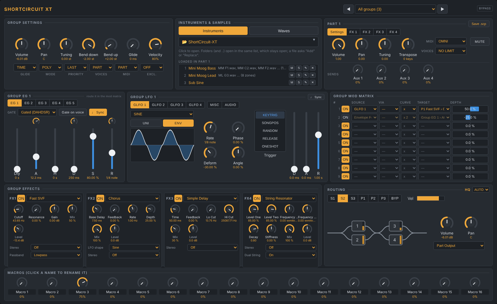
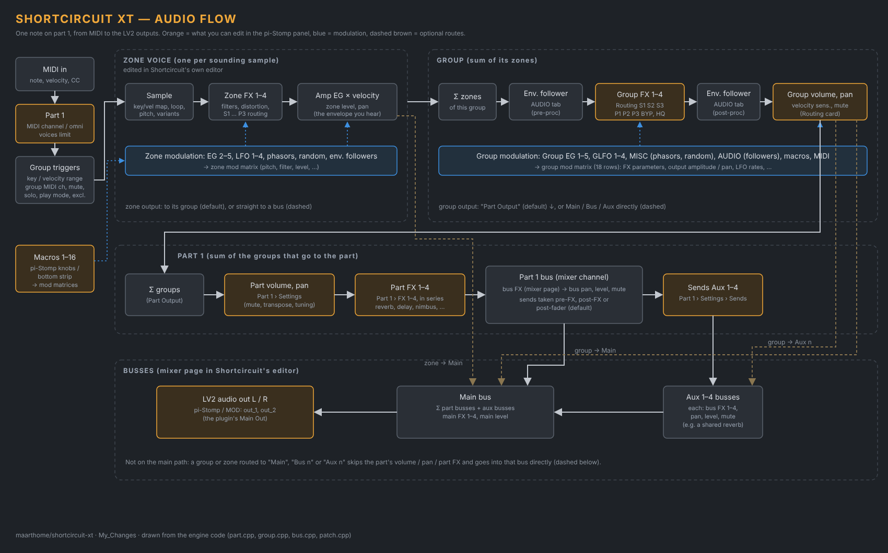

# Shortcircuit XT on the pi-Stomp — what was made and how to use it

Fork: [maarthome/shortcircuit-xt](https://github.com/maarthome/shortcircuit-xt), branch
**`My_Changes`** (the default branch). Original project:
[surge-synthesizer/shortcircuit-xt](https://github.com/surge-synthesizer/shortcircuit-xt).

This document covers everything built on this branch and the procedures to build, install and
use it. The technical file list is in [`MY_CHANGES.md`](../MY_CHANGES.md).



---

## 1. What was made

| Part | What it is |
|---|---|
| **Native LV2 plugin** `ShortcircuitXT.lv2` | Shortcircuit XT built as an LV2 for the Raspberry Pi 5 (aarch64, Debian trixie). Shortcircuit's own engine and plugin code are compiled into `scxt_lv2.so`; there is no CLAP wrapper and no `.clap` loaded at runtime. URI `https://github.com/maarthome/shortcircuit-xt#lv2`, shown in MOD as **Shortcircuit XT**. |
| **Ports** | MIDI in, stereo audio out (L/R), 16 control ports = the 16 macros of part 1, an atom in/out pair for the panel. |
| **State** | The whole Shortcircuit state is saved in the LV2 state: pedalboards, presets and snapshots load back exactly. |
| **MOD panel** (modgui) | A 1650 × 1010 panel for MOD-UI on the pi-Stomp that mirrors Shortcircuit's group editor (see chapter 4). |
| **Bridge** `scxt_bridge.cpp` | Turns panel edits into the same engine messages Shortcircuit's own editor sends, and reads the engine back every 200 ms so the panel follows presets, loads and the editor. |
| **X11 editor** | The full Shortcircuit editor as LV2 UI for Zynthian (over VNC), jalv and Carla. MOD cannot show it; it uses the panel instead. |
| **Build script** `build_scxt.sh` | Installs dependencies, builds, shows a progress line, packages (`.deb`), deploys to the pi-Stomp or the Zynthian, copies instruments. |
| **Zynthian widget** `zynthian/ShortcircuitXT-zyngui.lv2` | Knob names and control pages follow the macro names of the loaded preset. |
| **`generate_ttl.sh`** | Writes fixed macro names into the bundle's `.ttl` from a saved state (for hosts without the widget). |
| **AKP group names** | Shortcircuit's AKP importer named every group "AKP Group 0"; groups are now named after the `.akp` file. |

---

## 2. Building and installing

All commands run on the **dev Pi 5**. The pi-Stomp is `pistomp@pistomp.local`.

### 2.1 First build

```bash
cd ~/git
git clone -b My_Changes https://github.com/maarthome/shortcircuit-xt.git
cd shortcircuit-xt
JOBS=4 ./build_scxt.sh
```

The first build takes hours (later builds only recompile what changed). It adds a temporary 6 GB
swap file. The full compiler output goes to `ignore/build-pi.log`.

### 2.2 Update and install on the pi-Stomp (the usual procedure)

Once, so `--deploy` can log in without a password:

```bash
ssh-copy-id pistomp@pistomp.local
```

Every time there are changes:

```bash
cd ~/git/shortcircuit-xt
git pull
JOBS=4 PISTOMP=pistomp@pistomp.local ./build_scxt.sh --deploy --no-deps
```

This copies the bundle to `~/.lv2` on the pi-Stomp and restarts mod-host and mod-ui. Reload the
MOD web page afterwards so the new panel is used.

### 2.3 Copy instruments to the pi-Stomp

```bash
cd ~/git/shortcircuit-xt
JOBS=4 PISTOMP=pistomp@pistomp.local ./build_scxt.sh --deploy --no-deps --instruments ~/instruments
```

They land in `/home/pistomp/.local/share/ShortCircuit-XT/` (the panel's **Instruments** folder).
Samples must stay at the same path as when a patch was saved.

### 2.4 Other ways to install

Debian package for the pi-Stomp:

```bash
cd ~/git/shortcircuit-xt
JOBS=4 ./build_scxt.sh --deb --lv2-dir /home/pistomp/.lv2
scp dist/shortcircuit-xt-lv2_*.deb pistomp@pistomp.local:
ssh -t pistomp@pistomp.local 'sudo apt install ./shortcircuit-xt-lv2_*.deb'
```

Zynthian (with the widget; enable "Shortcircuit XT" once in webconf › Software › LV2 Plugins):

```bash
cd ~/git/shortcircuit-xt
JOBS=4 ./build_scxt.sh --zynthian
```

### 2.5 Build options

| Option | Effect |
|---|---|
| `--no-deps` | don't install build packages |
| `--deploy` | install on the pi-Stomp (`PISTOMP=user@host`) and restart MOD |
| `--lv2-dir DIR` | LV2 folder on the pi-Stomp, or the `.deb`'s install folder |
| `--zynthian` | install on the Zynthian (`ZYNTHIAN=root@zynthian.local`) |
| `--deb` / `--deb-only` | make a `.deb` (after building / from the last build) |
| `--instruments DIR` | copy instruments to the pi-Stomp or into the `.deb` |
| `--with-clap` | also build the plain CLAP |
| `JOBS=n` | parallel compile jobs (use 4 on the Pi 5) |
| `VERBOSE=1` | full compiler output instead of the progress line |
| `SWAP_GB=n` | temporary swap size (default 6, 0 = none) |
| `MAX_PARAMS=n` | macro control ports (16 = part 1, 256 = all parts) |

### 2.6 Syncing with the original project

```bash
cd ~/git/shortcircuit-xt
git remote add upstream https://github.com/surge-synthesizer/shortcircuit-xt.git
git fetch upstream
git checkout My_Changes
git merge upstream/main
git push origin My_Changes
```

(`git remote add` is needed only once.) The only upstream file changed is
`src/clients/CMakeLists.txt`, so merges rarely conflict.

---

## 3. How Shortcircuit XT is organised

- **Part:** a complete instrument on one MIDI channel. Shortcircuit has 16; the panel always
  works on **part 1**.
- **Group:** a layer inside the part (e.g. one articulation, or one loaded instrument). It has its
  own settings, 4 effects, 5 envelopes (EG 1–5), 4 LFOs, misc and audio modulators and an
  18-row mod matrix.
- **Zone:** one sample in a group, with its key and velocity range. Zones have their own amp
  envelope, effects and mod matrix; those are edited in Shortcircuit's own editor.
- **Macros:** 16 per **part**, shared by all groups. Each group's mod matrix decides what a macro
  does in that group.

### Audio flow



1. **MIDI → part 1 → group triggers** (channel, key/velocity range, mute, solo, play mode).
2. **Zone voice**, one per sounding sample: sample → zone FX 1–4 → amp envelope × velocity
   (the envelope you hear).
3. **Group** (sum of its zones): envelope follower (pre) → group FX 1–4 with routing S1…P3 →
   envelope follower (post) → group volume and pan.
4. **Part 1** (sum of its groups): part volume and pan → part FX 1–4 → part 1 bus → sends to
   Aux 1–4.
5. **Busses:** the part bus and the Aux 1–4 busses (each with its own effects) → main bus →
   LV2 out L/R.

A group or zone whose output is set to "Main", "Bus n" or "Aux n" skips part 1's volume, pan and
part effects.

---

## 4. The panel, section by section

Layout, top to bottom:

| Row | Left | Middle | Right |
|---|---|---|---|
| 1 | Group settings | Instruments & samples, loaded list | Part 1 (Settings, FX 1–4, Save) |
| 2 | Group EG 1–5 | Group LFO 1–4, MISC, AUDIO | Group mod matrix |
| 3 | Group effects FX1–FX4 | — | Routing |
| 4 | Macros 1–16 (one strip) | | |

General: drag a knob up/down (Shift = fine), double-click for its default. Value texts come from
Shortcircuit itself (e.g. "43.65 Hz", "1/4 note").

### 4.1 Group selector (top bar)

- **All groups** (default): every edit goes to all groups of part 1; the panel shows group 1's
  values.
- **Group n: name**: edits only that group. ◀ ▶ step through All, 1, 2, … Clicking a row in the
  loaded list also selects that group.

### 4.2 Group settings

Volume, pan, tuning, bend down/up, glide time and mode, velocity sensitivity, play mode (poly,
piano, mono, legato), note priority, voices, MIDI channel, exclusive group.

### 4.3 Instruments & samples

- **Instruments** shows `.sfz .sf2 .akp .exs .gig .multisample` and Shortcircuit's own `.scp`
  (part) and `.scm` (multi). **Waves** shows `.wav .flac .aif .aiff .mp3 .opus`.
- One drop-down list: `..`, sub-folders and files, then "Go to": ⌂ Instruments, ⌂ Home,
  ⌂ USB / media, your ★ saved folders, ☆ Remember / ✖ Forget this folder. The list stays open
  while you browse folders.
- The last folder and saved folders are kept in `~/.config/ShortCircuit-XT/browser.txt`.

**Procedure — load something:**

1. Choose Instruments or Waves, open the list, browse to the file and click it.
2. The dialog asks:
   - **Add to part 1** — adds it as new group(s).
   - **Replace group N: name** (only when one group is selected) — a wave replaces that group's
     samples and the group keeps its settings and takes the wave's name; an instrument takes the
     group's place.
   - **Replace part 1** — empties part 1 first.
   - **Cancel**.
   A `.scp` or `.scm` always replaces.

### 4.4 Loaded in part 1 — group management

Each row: number, group name, its samples, and four buttons:

| Button | Does |
|---|---|
| **M** | mute the group |
| **S** | solo the group: while any group is soloed, only soloed groups sound (solo beats mute) |
| **✎** | rename the group |
| **✕** | delete the group (asks first) |

Groups you do not hear are **struck through**: the muted ones, or — while a group is soloed —
every group that is not soloed.

### 4.5 Part 1 (top right)

- **Settings:** volume, pan, tuning, transpose, MIDI channel (OMNI or CH 1–16), voices (no limit
  or 1–256), MUTE, and **Sends** to Aux 1–4.
- **FX 1–4:** part 1's own effects, in series: on/off, type (Reverb 1/2, Flanger, Phaser, Dual
  Delay, Treemonster, Nimbus, Rotary Speaker, Floaty Delay, Bonsai), tempo sync and the effect's
  knobs. The tab shows the effect name.
- **Save .scp** (see 4.6).

### 4.6 Procedure — save part 1

1. Click **Save .scp**.
2. If part 1 came from a `.scp` or was saved before, the dialog shows the current file:
   - **Save to <file>** overwrites it;
   - **Save as new…** asks for a name.
   Otherwise it asks for a name straight away.
3. A plain name is saved in the Instruments folder as `<name>.scp`; a full path (starting with
   `/`) is used as it is.
4. Tick **Put the samples in the file too** for one big file that can be moved anywhere;
   without it the file refers to the samples where they are.
5. The status line in the top bar shows "Saved <file>" or the error.

The saved file contains everything: groups, zones, effects, envelopes, LFOs, matrix, macro names.
Load it back via the browser.

### 4.7 Group EG 1–5

Dly A H D S R sliders, shape knobs above A, D and R, gate mode (Gated / No sustain / Oneshot),
tempo sync (times as note lengths) and Gate on voice.

Group EGs are **modulation sources only**: they change the sound only through a mod matrix row.
The envelope you hear per note is each zone's amp envelope (Shortcircuit's editor).

**Procedure — make a group EG audible:** in the mod matrix set a row to source **Group EG › GEG1**
and target **Output › Amplitude**, depth up.

### 4.8 Group LFO 1–4, MISC, AUDIO

- **GLFO 1–4:** shape (sine, ramp, tri, saw-ramp, square-tri, noise, S&H, env, step) with a
  picture, UNI, ENV (D A R), Rate, Phase, Deform, Angle, tempo sync, trigger (KEYTRIG, SONGPOS,
  RANDOM, RELEASE, ONESHOT). The ENV shape shows its own DAHDSR and LOOP. Step sequences are
  edited in Shortcircuit's editor.
- **MISC:** phasors A–D (voice or song sync, rate n/m, note / triplet / dotted / x BPM, up or
  down, phase) and random sources A–D (unipolar, bipolar, normal, half-normal, boolean ±,
  ternary).
- **AUDIO:** envelope followers A and B: attack, release, gain, follow **Pre-Proc** (before the
  group effects) or **Post-Proc** (after), stereo link.

All of these are mod matrix sources. Envelope follower **Left/Right** in the matrix are its two
channels; with stereo link on only **Left** is updated, so use Left.

### 4.9 Group effects FX1–FX4

Per slot: on/off, effect type (Shortcircuit's list: filters, delay, distortion, EQ, modulation,
reverb, generators, …), the effect's knobs, Mix and Level, and choice settings as drop-downs.

**Where is the filter?** A filter is an effect type. Put one in a group FX slot (Filters: Fast
SVF, Fast SVF 24 dB, Vember Classic, K35, Linear/Vintage Ladder, OB-Xd 4-Pole/Xpander,
Cutoff/Resonance Warp, Tripole, Sample & Hold, Utility Filter, Morph, Static Phaser). Zone filters
are set in Shortcircuit's editor.

**Procedure — filter sweep with an LFO:** FX1 = Fast SVF; matrix row: source GLFO 1, target
**P1 Fast SVF › Cutoff**, depth to taste.

### 4.10 Group mod matrix

18 rows: on/off, Source, Via, Curve, Target, Depth (drag left/right, Shift fine, double-click 0).
Sources: LFOs, EGs, MIDI (mod wheel, pitch bend, aftertouch, CC 0–127), macros, random, phasors,
envelope followers, key tracking, voices. Targets: every effect parameter ("P1 Fast SVF ›
Cutoff"), output amplitude / pan, LFO and EG parameters, mod depths.

### 4.11 Routing

S1 S2 S3 P1 P2 P3 BYP — the order of the 4 group effects (S = series patterns, P = parallel
patterns, BYP = all off), drawn as blocks with their mix as a bar. Also Vel (velocity
sensitivity), Volume, Pan, output (Part Output, Main, Bus 1–16, Aux 1–4) and HQ (oversampling
off / auto / on).

### 4.12 Macros 1–16

One strip along the bottom. These are the plugin's 16 control ports: they also appear on the
pi-Stomp display and can be assigned to its knobs. **Click a name to rename it**; names are saved
with the part (`.scp`) and the pedalboard. Macros are per part; each group's matrix decides what
they do.

**Procedure — a pi-Stomp knob for the filter:** rename Macro 1 to "Cutoff"; matrix row: source
**Macro › Macro 1**, target **P1 Fast SVF › Cutoff**; assign Macro 1 to a knob in MOD.

---

## 5. Files on the pi-Stomp

| Path | Contents |
|---|---|
| `~/.lv2/ShortcircuitXT.lv2/` | the plugin bundle (with the panel in `modgui/`) |
| `~/.local/share/ShortCircuit-XT/` | instruments, and saved `.scp` parts |
| `~/.config/ShortCircuit-XT/browser.txt` | last folder, saved folders, current part file |

---

## 6. How the panel talks to the plugin (for maintenance)

- The panel uses **LV2 patch parameters** (`src/clients/lv2/scxt_params.h`): float values for
  settings, strings for lists and edits.
- mod-host passes at most about 500 bytes per message, so long texts (folder listings, effect
  descriptions, matrix lists, names) are sent in pieces `"<tag> <n>/<total>|<piece>"` and joined
  by the panel.
- Edits go to a worker thread that sends Shortcircuit's own engine messages (as its editor does),
  e.g. `UpdateGroupOutputFloatValue`, `SetSelectedProcessorType`, `UpdateGroupRoutingRow`,
  `UpdatePartFullConfig`, `SetBusEffectStorage`, `MuteOrSoloGroup`, `SavePart`,
  `SetMacroFullState`.
- Things that must be read safely (effect descriptions, names) are copied on the audio thread
  between two process calls.

Main files:

| File | Role |
|---|---|
| `src/clients/lv2/clap2lv2.cpp` | the LV2 plugin, ports, state, X11 UI |
| `src/clients/lv2/scxt_bridge.cpp` | panel ↔ engine |
| `src/clients/lv2/scxt_params.h` | parameter list |
| `src/clients/lv2/clap2lv2_ttl.cpp` | writes the `.ttl` files |
| `mod/modgui/javascript-shortcircuit-xt.js` | the panel |
| `mod/modgui/stylesheet-shortcircuit-xt.css` | the panel's look |
| `build_scxt.sh` | build / deploy |

---

## 7. Troubleshooting

| Problem | Check |
|---|---|
| Plugin not in MOD | `ssh pistomp@pistomp.local 'ls ~/.lv2/ShortcircuitXT.lv2'`, then restart MOD (below) |
| Old panel after an update | reload the MOD web page (Ctrl+F5) |
| An envelope or LFO edit does nothing audible | group EGs / LFOs / MISC / AUDIO need a mod matrix row |
| No sound from a group | is it muted, or is another group soloed (struck through)? Group output set to a bus? |
| Samples missing after moving files | samples must stay at the saved path, or save with "Put the samples in the file too" |

Restart MOD on the pi-Stomp:

```bash
ssh pistomp@pistomp.local 'sudo systemctl restart mod-host mod-ui'
```

Check the bundle on the dev Pi:

```bash
LV2_PATH=~/git/shortcircuit-xt/dist-linux-aarch64 lv2ls
```

---

## 8. Not done (yet)

- Choosing files with the pi-Stomp's own display and buttons (planned for later).
- Parts 2–16: the panel works on part 1 only, by choice.
- Zone editing (key ranges, loops, zone envelopes and filters): use Shortcircuit's own editor.
- Audio inputs: Shortcircuit XT has none; left out by choice.
